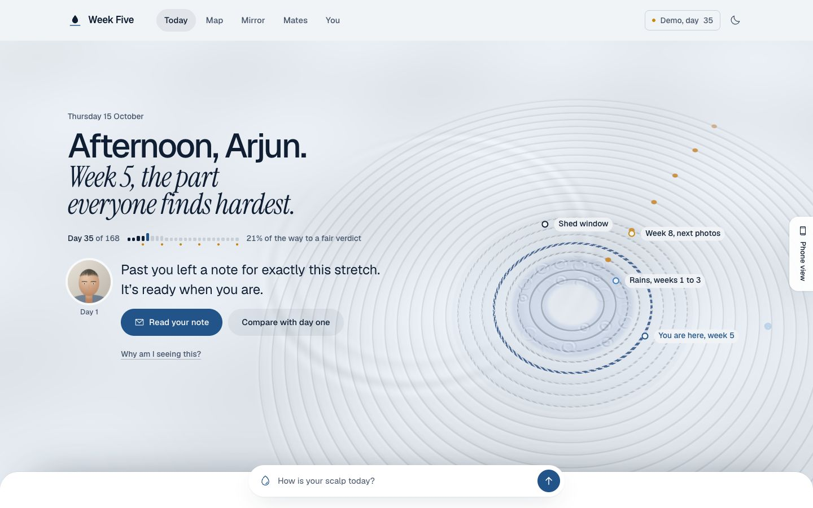
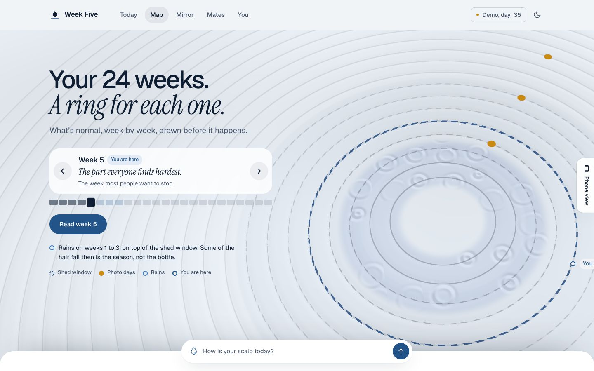
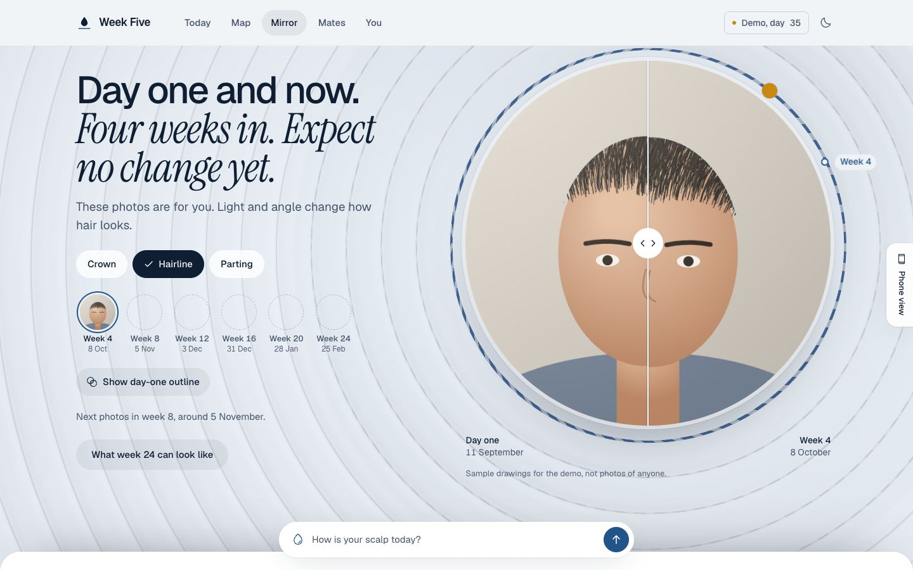
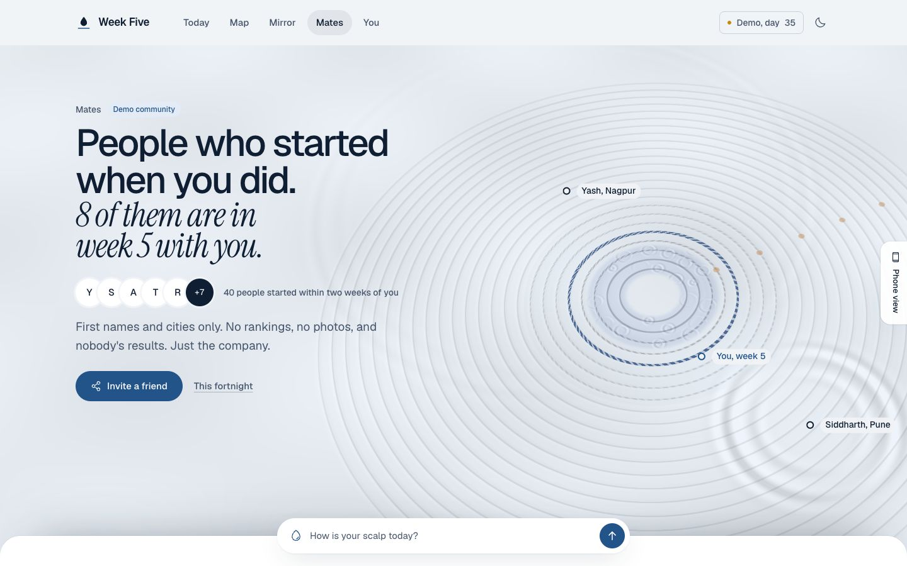
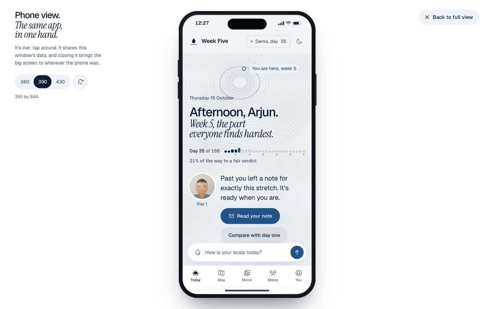

# Week Five

**The map and the mirror for the first 24 weeks of hair regrowth treatment.**
An independent concept for the Mosaic Fellowship Builder Challenge (brand: Man Matters). Not made, reviewed or endorsed by Man Matters or Mosaic Wellness.



## The problem, in three sentences

People who start minoxidil and stop mostly stop between weeks three and seven, exactly when shedding is expected. Nobody prepares them for the shed, and they can't see their own progress, so the bathroom floor becomes the verdict. It is a problem of information and timing, not of the product.

Week Five gives them **a map** (what is normal, week by week, for their start date and their city's rains) and **a mirror** (day-one photos, monthly comparisons, an honest illustration of a typical week 24), and it says the right sentence on the right day.

## Try it in two minutes

```bash
pnpm install
pnpm dev
```

Open http://localhost:3000.

1. The intro plays once (scroll, swipe or arrow keys; Skip is always there).
2. On the welcome screen choose **Try it with sample data**. You land on Today as a fictional person on **day 35**, the middle of the shed window.
3. Read Today's note: it reframes the shed with the day-one drawing beside it and the note they wrote to "week-five me".
4. Tap **How is your scalp today?**, answer "More than usual" and "A lot". The answer comes back with day one and the map. The reorder prompt is now held for 24 hours: reassurance first, shopping later.
5. Open **Map** and step through the weeks; open **Mirror**, drag the divider, then **See the illustration** for the week-24 thinking sequence.
6. Open **Mates** (a labelled demo community, no rankings, no photos), **Supply** (from Today) and **You**.
7. Use the **Demo, day 35** chip to jump to day 1, 60, 110 or 168, or switch sample person (worried, monsoon starter on quick commerce).
8. On a laptop, press the **Phone view** tab on the right edge of the screen: the same app, live, inside a phone in the middle of a white page. Try 360, 390 and 430 widths. Closing it brings the big screen to wherever the phone was.

To set up a real plan instead, choose **Start setup** (or open `/dev/qr` in dev and scan a pack code with your phone).

### On a phone

The camera needs `localhost` or HTTPS. For a phone on the same network run `pnpm dev:https` and open the network address it prints; without HTTPS the photo steps fall back to choosing a photo from the gallery. `/dev/qr` (dev builds only) shows QR codes for the fictional packs that open `/start?sku=...&reg=...&batch=...`.

## What is in it

| | |
|---|---|
| Scroll intro | A glass dropper on a light 3D pool; its drop falls and the ripple freezes into the 24 week rings. GSAP scrubbed, keyboard and screen-reader paths, reduced-motion sequence. |
| QR entry and setup | Nine questions, one per screen, each with why it is asked; the camera moves through the pool and the answers draw your map (rains, start, photo days). Resumable. English or Hinglish. |
| The briefing | "The briefing you skipped" for quick-commerce and pharmacy buyers, a short version for assessment customers. |
| Day-one photos | Three guided views through a round lens at the centre of the rings, ghost outlines, a live light meter, timer, gallery fallback, optional painted area. Photos never leave IndexedDB. |
| Today | The plan from above (the rings are the progress ring), the greeting in two voices, the day's note from the reassurance engine with "Why am I seeing this?", the routine with one-tap done, day one and now, supply, mates, week 24 and the way out. |
| Reassurance engine | 52 rule-based cards in `src/content/insights.json`: day, season, products, channel, latest check-in, time of day, photos, the note. Red flags override everything. |
| Check-in | Hair fall and worry in words, missed applications, red flags, a note; answered in place. |
| Map | Week by week on the rings, with the rains, photo days, the note to week five, and a page per week. |
| Mirror | Day one in a lens, the later photo behind a divider; monthly photo days; the week-24 illustration (on device, labelled, one typical case). |
| Before you stop | Day one, where you are, the note, a neutral fact, and three equal choices: keep going, pause with a restart date, talk to a doctor (with a printable summary). |
| Supply and reminders | Runway from the newest pack, reorder only after reassurance, packs, a calendar file (weekly check-ins, photo days, the note, reorder points, restart), notifications while the app is open, in-app banners. |
| Routine | Timing suggestions from a rule table (`src/content/routines.ts`): spacing, roller nights, gummies with food, wash days, travel days. Never a dose. |
| Mates | A seeded, fictional cohort that started within two weeks of you, warm events, nudges that stay local, invite a friend, and how it would work for real. |
| You and your data | Edit every answer, routine times and roller nights, reminders, theme, language, sample data, export everything as JSON, delete everything. |
| Phone view | A side button on wide screens that shows the live app inside a phone, at 360, 390 or 430 wide. |
| Offline and install | Hand-written service worker, web app manifest, install nudge after the day-one photos. |

## Privacy, by construction

No accounts, no server, no analytics, no third-party requests (fonts are self-hosted). The plan lives in `localStorage`, photos in IndexedDB, both only in this browser. Export and delete live in You, Your data. The app ships empty of anyone's data, which is how it meets the challenge rule on customer personal data. Demo people are fictional.

## Deliberately not built

Accounts and sync, analytics SDKs, a backend, any AI reading of photos, any dose, strength or prescription, a cart or payments, real community features, scheduled push notifications (they need a server), and statistics presented as real.

## How Mosaic could measure it

Nothing leaves the device in this build. If it ran for real, these events would tie the app to the reorder metric:

| Event | Why it matters |
|---|---|
| `baseline_taken` (day) | Customers with a day-one photo should reorder more at month two |
| `checkin_completed` (week, shed, worry) | How many reach weeks 3 to 7 still engaged |
| `letter_written`, `letter_revealed` | Tests the commitment device |
| `pause_opened` (day), `pause_choice` | The cliff itself, made visible |
| `reorder_shown`, `reorder_tapped` (days since reassurance) | Tests the sequencing rule |
| `channel` at setup | Splits the quick-commerce prediction |

Two predictions Mosaic can test with its own order data today:

1. Customers whose first minoxidil order falls between June and September reorder at month two less often than those who start between November and February.
2. First-time minoxidil buyers on quick commerce reorder less often than those who came through the hair assessment.

## Screens

| | |
|---|---|
|  |  |
|  |  |

## Stack and scripts

Next.js 16 (App Router, static export), TypeScript, Tailwind CSS 4 with CSS-variable tokens, Three.js (the pool), GSAP (intro only), Motion, Zustand, idb, zod, Phosphor icons, Vitest and Playwright. Node 22 or newer, pnpm.

| Command | What it does |
|---|---|
| `pnpm dev` | Dev server on localhost:3000 |
| `pnpm dev:https` | The same over HTTPS, for the camera on a phone |
| `pnpm check` | Lint, types, unit tests, copy rules (no dashes, no banned words), production build |
| `pnpm e2e` | Playwright end-to-end tests on phone, tablet and desktop sizes |
| `pnpm build:pages` then `NEXT_PUBLIC_BASE_PATH=/week-five pnpm serve` | Build and serve exactly as GitHub Pages will, under `/week-five` |

`.github/workflows/pages.yml` deploys to GitHub Pages once the repository is pushed and Pages is set to GitHub Actions.

## Where things are

- `docs/BUILD_DOC.md` the spec, `docs/DESIGN_SYSTEM.md` tokens and motion, `docs/SCREENS.md` wireframes, `docs/CONTENT_BANK.md` all copy, `docs/DATA_MODEL.md` storage, `docs/DECISIONS.md`, `docs/PROGRESS_LOG.md`.
- `src/app` routes, `src/components` features and the pool, `src/lib` the unit-tested logic (journey maths, season, insights, runway, reminders, routine, providers), `src/content` the copy and rule tables.

## Not medical advice

Week Five is not a medical device and does not diagnose anything. It never suggests a dose. Follow your pack leaflet and your doctor. If something feels wrong, such as pain, a rash, dizziness or swelling, see a doctor.

## License

MIT, see `LICENSE`. The concept, copy and code are the author's; no Man Matters logos, product photography or trademarked assets are used.
