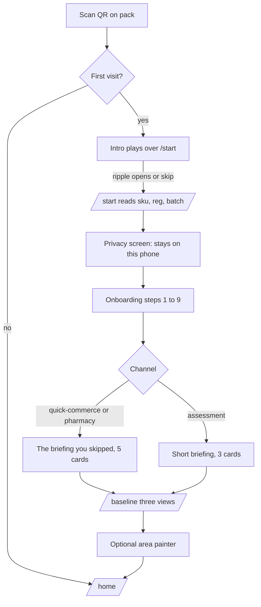
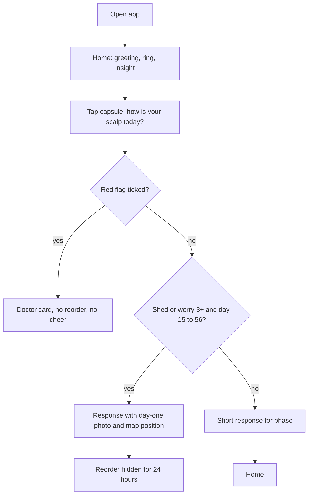
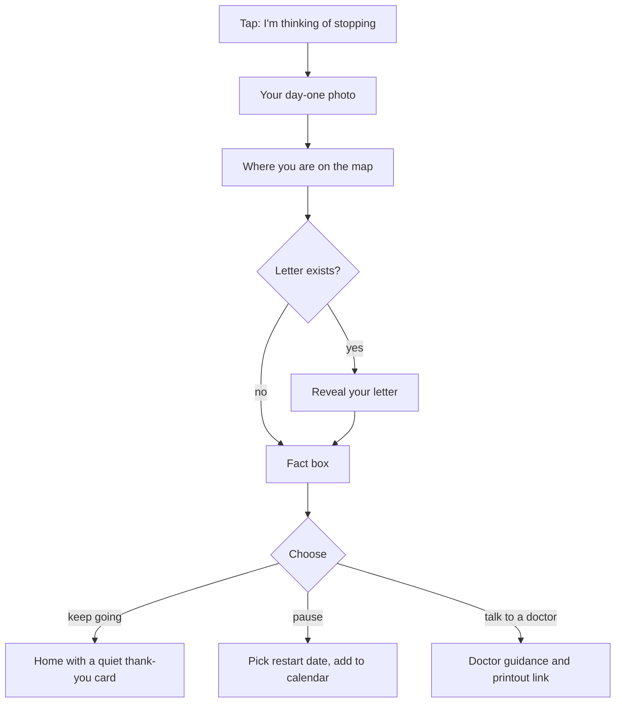
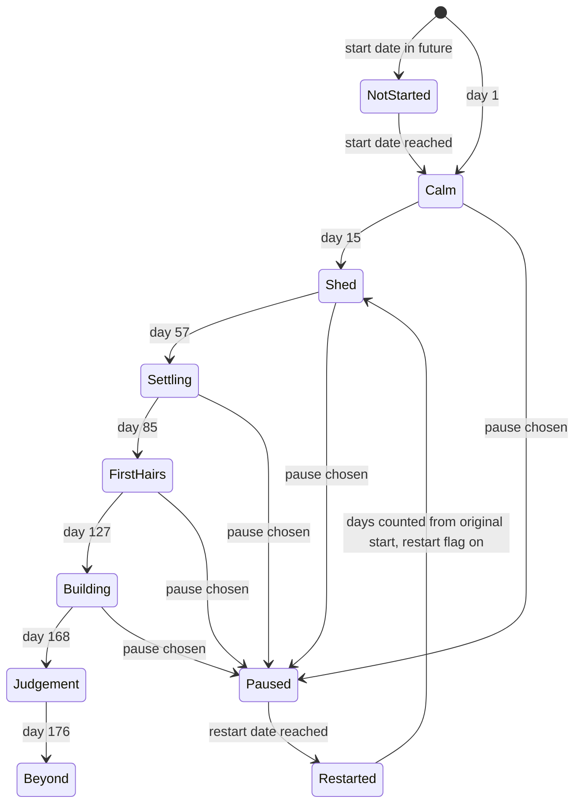
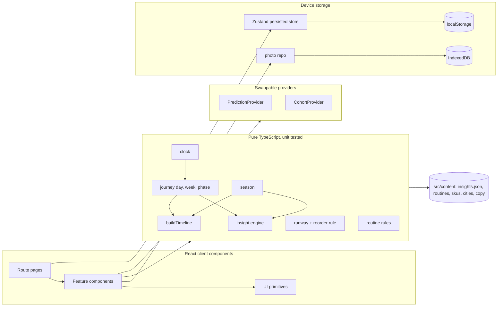

# Week Five: build document

The master reference. Research and guardrails live in `HANDOFF.md`; scope overrides in `CLAUDE_CODE_KICKOFF_PROMPT.md`. This document turns both into something buildable. Where they disagree, the kickoff prompt wins and the choice is logged in `DECISIONS.md`.

## 1. Vision

A new customer scans the QR on their pack, and for the next 24 weeks the app says the right sentence on the right day. In week five, when the bathroom floor says "this is failing", the app puts their day-one photo, their place on the map and their own words next to that feeling.

Part 1 of the challenge ended with: "Part 2 is my attempt to give them both the map and the mirror." This app is that attempt.

## 2. Who it is for

| Person | What they need from the app | Where they come in |
|---|---|---|
| The quick-commerce buyer | The briefing nobody gave them. Bought in ten minutes, skipped the assessment and the doctor | QR on pack, "briefing you skipped" variant |
| The assessment-kit customer | A reminder of what the doctor said, at the moment they forgot it | QR on pack, short briefing |
| The monsoon starter | An explanation for why it feels twice as bad | Season overlay on the map and insight cards |
| The person someone else judged | Something to show the mother, flatmate or barber whose remark became the verdict | Show someone card (stretch) |
| The Mosaic reviewer | To see week five without waiting five weeks | Demo mode with a day jumper |

Context: urban Indian men, 18 to 45+, on a phone, often in a hurry, some anxious or embarrassed. Mid-range Android is the performance target.

## 3. The problem in one paragraph

Customers on minoxidil stop between weeks three and seven, the window in which shedding is expected, because nothing prepares them to read the shed as part of the process and nothing lets them see their own progress. The briefing, if it happens, is a three-minute call at the start; doubt arrives weeks later. Monsoon starters get a seasonal shed on top. Quick-commerce buyers get no briefing at all. It is a problem of information and timing, not product efficacy, price or convenience. (11 interviews: 9 of 11 stopped or came close, all inside weeks 3 to 7, median week 5.)

## 4. Features and acceptance criteria

Each feature lists the behavioural idea it carries, then testable criteria. "Day" means journey day.

### F1. QR entry (`/start`)
Idea: meet them at the pack, the one touchpoint every channel shares.
- Opening `/start?sku=WF-SOL-60&reg=2026-10-01&batch=B2291` shows "Welcome, let's set up your plan" and the product name from `src/content/skus.ts`.
- `sku`, `reg` and `batch` are validated with Zod. Unknown SKU or bad date shows a friendly "We couldn't read that code" with manual product pick. No other parameters are read or stored.
- Opening the app with no parameters leads to manual product and start date entry.
- Scanning a second pack later appends to `profile.packs` and refreshes the runway, without restarting onboarding.
- `/dev/qr` renders QR codes for every fictional SKU, pointing at the current origin, and is excluded from production navigation and the sitemap (built only when `NEXT_PUBLIC_DEV_PAGES=1`).

### F2. Scroll intro (overlay on `/start`, replay at `/intro`)
Idea: forewarning (McGuire 1961) delivered before the first question, while the app loads.
- First visit only (tracked by `weekfive:intro`). It plays over the welcome screen and its ripple opens onto it. "Replay the intro" in About opens `/intro`.
- Six beats tied to scroll segments, told on the 3D pool (design v3): the dropper turns upright, the bulb squeezes, a drop forms and falls, its ripple freezes into the 24 week rings, other drops land, and the camera settles onto the welcome screen.
- Skip is always visible and focusable. A thin progress line shows position.
- Arrow keys, Page Down and Space advance a beat. Screen readers get all six sentences as a list.
- Reduced motion: auto-advancing sequence of the six beats, 4 s each, with pause and skip, cutting between the same 3D poses with no travel.
- Holds near 60 fps with 4x CPU throttling in Chrome DevTools (transforms and opacity only).
- Onboarding and Home bundles are prefetched while the intro plays.

### F3. Onboarding story (`/onboarding`)
Idea: collect only what changes the plan, and say why each thing is asked.
- One question per screen, nine steps, progress thread along the top, answers in the thumb zone, 44 px minimum targets.
- The first screen after the splash says "Your details and photos stay on this phone."
- Every step has a one-line "why we ask" and every optional step has Skip.
- State saved after each step. Closing the tab and reopening resumes at the same step.
- Finishing routes to the briefing variant (quick-commerce or loose purchase gets "The briefing you skipped", others get the short version), then to baseline capture.
- A first-time user finishes onboarding plus baseline in under three minutes on a phone (timed in Playwright with scripted input, plus a manual run).

### F4. Briefing
Idea: inoculation. Same five facts, framed for whether they were briefed before.
- Five swipeable cards (swipe, buttons and arrow keys). Short variant shows three.
- Copy in CONTENT_BANK. References linked.

### F5. Baseline capture (`/baseline`)
Idea: loss aversion makes the pillow vivid and growth invisible; a photo makes the baseline as vivid as the loss.
- Intro, then three views in order: crown, hairline and temples, parting. Each has an SVG ghost outline over the camera and a short instruction. Then an optional area painter, then a close.
- The viewfinder is a round lens at the centre of the user's 24 rings (design v3). What it shows is what is kept: the centred square of the frame.
- Live lighting meter from a 64x48 copy of the middle of the frame, mean luminance every 250 ms: too dark (< 70), good (70 to 190), too bright (> 190). The reading is saved with the photo.
- "Same spot, same time of day" is said before the first shot; the hour of the first kept photo is stored (`settings.photoHour`) and the close says when and at what time the next photos are due.
- Camera through `getUserMedia` with `facingMode` as a preference: front camera for the hairline, back camera for crown and parting, switchable. A 3 second timer (on by default for crown and parting, cancellable). If denied, unavailable or on an insecure origin, "Choose a photo" opens `<input type="file" accept="image/*" capture>` with the same guidance.
- Photos re-encoded through canvas (strips EXIF, centred square, at most 1600 px, never mirrored) and saved to IndexedDB as week 0. A retake replaces the old photo with its mask. Retake and delete (two taps) per photo on the close.
- Optional area painter: soft brush on any of the three photos (opens on the one matching the setup worry), saved as a 512 px PNG mask. Undo, clear, brush size, and "Mark the middle for me" as the keyboard path.
- After all three: `navigator.storage.persist()` and an install nudge.

### F6. Home dashboard (`/home`, nav label Today)
Idea: goal-gradient (Kivetz et al. 2006). Show the distance covered, not just the distance left.
- Design v3: the page opens on the pool, looking down on the user's 24 rings. Weeks behind them are drawn firmer, their week is lit, the shed window, rains and photo days are on the water, and other people's drops land once. The rings are the progress ring; a line of 24 ticks says the same thing precisely ("Day 35 of 168", "21% of the way to a fair verdict").
- Greeting in two voices: "Evening, Arjun." then the phase ("Week 5, the part everyone finds hardest."). "Still up, Arjun?" at night.
- Today's note: one sentence picked by priority from the insight rules (red flags first). Phase 5 ships a compact version (`src/lib/today-note.ts`); Phase 6 replaces it with the full engine and "Why am I seeing this?". When the note is about the day-one photo, the photo sits beside it.
- A sheet rises over the water with: Today (the day's slots from the products, one-tap done, streak), Day one and now (the baseline next to the latest photo of the worry area), Supply (runway, reorder only at 10 days or less and never within 24 hours of an uneasy check-in), the people who started when you did (Demo community), the week-24 illustration teaser, and Thinking of stopping.
- Bottom capsule "How is your scalp today?" opens the quick check-in sheet (F9).
- Skeletons while photos load. Empty states for no photos (take them), no check-ins (the bar pulses once, a note after a week), no pack scanned (add one).
- Demo, day 35: the note reframes the shed with the day-one drawing beside it and the map behind it (the letter reveal comes in Phase 6).
- The pool pauses whenever the sheet covers it. Dark theme gets a night pool.

### F7. The map (`/map`, `/map/week/[n]`)
Idea: expectation confirmation (Oliver 1980). Tell them what normal looks like before it happens.
- Built in Phase 6 on the pool (design v3): the 24 rings are the map. A week picker (previous and next, arrow keys, or the 24 small bars) moves the camera outward ring by ring and lights the chosen ring; "Read week n" opens its page. The rains are said in words under it, with a legend for the rings. Below, a sheet lists all 24 weeks grouped by phase, with the note to week five and the way out beside it. `/map` and the week pages share one pool (a nested layout), so the camera travels between them. Week copy lives in `src/content/weeks.ts`.
- 24 weeks as the same strip used on Today (compact on phones, labelled on desktop), plus a week-by-week list. Phases labelled, "You are here" marker, monthly photo dots, the letter's week marked.
- Season overlay band where the shed window overlaps the user's monsoon, with its own explanation.
- Each week page (static params 1 to 24): what commonly happens, what to do this week, what is not a reason to worry, when to see a doctor, references.

### F8. Reassurance engine (insight cards)
Idea: the right sentence on the right day, like a cycle tracker.
- Rules in `src/content/insights.json` (44+ cards, two copy variants each). Inputs: day, phase, season overlap, products, channel, latest check-in (shed, worry, missed doses, red flags), time of day, photos taken, letter status, recent intercepts.
- Selection: filter eligible, red flags override everything, then highest priority, then not shown in the last 7 days, then a stable hash of the date picks the variant.
- "Why am I seeing this?" sheet shows the plain-language trigger ("You're on day 34 and said hair fall is more than usual") and the reference.
- Red-flag cards have no cheerful framing, no bounce, coral accent, and a direct "Talk to a doctor" action.
- Night (22:00 to 05:00) with worry 3+: calm card with a breathing circle (4 s in, 6 s out), no numbers.
- Built in Phase 6: 52 cards in `src/content/insights.json`, each with a structured trigger (`when`), refs, an optional action (`attach`) and two variants. `src/lib/insights.ts` picks: red flags outright, then priority; cards under priority 80 rest for 7 days after showing (today's pick stays all day); a hash of the date and the id picks the variant. Today logs one pick a day in `insightLog`. A paused plan gets its own card ("paused-now").

### F9. Check-in (`/checkin` and the capsule sheet)
Idea: give the feeling somewhere to go, and answer it with evidence.
- Hair fall and worry as five pills each, in words, with nothing chosen until the person chooses (no default to anchor on). Missed applications stepper (0 to 14). Red-flag checklist. Optional note (280 characters). Under 30 seconds.
- A native modal sheet: bottom sheet on phones, panel from the right from 768 px. Escape and tapping outside close it; focus returns to the bar.
- The answer replaces the form in place: copy from the response matrix (phase by doubt, doubt meaning hair fall or worry at 3 or more). Doubt in the shed window brings the day-one photo and the 24 ticks. Any red flag replaces all of it with the doctor card and the list of what was ticked.
- Saving updates Today at once (its note, its reorder rule).

### F10. Letter to week-five me
Idea: pre-commitment against present bias (O'Donoghue and Rabin 1999).
- Written during onboarding (optional) or later from Journey. Up to 400 characters. Set in the serif.
- Hidden until day 22 (start of week 4) or until the user opens the pause flow, whichever comes first. Reveal is a deliberate tap, with the date it was written.
- Built in Phase 6: written in setup or on the map (sealed straight away), shown sealed with its opening date, then "Your note is ready" with **Read your note**, which opens it in a sheet and records `revealedAt` and `revealedIn`. On Today, weeks four and five lead with the note, the day-one photo beside it.

### F11. Wait, before you stop (`/pause`)
Idea: put evidence next to the feeling, then respect the decision.
- Reachable from Today, Map and You ("Thinking of stopping?").
- Shows, in order: their day-one photo, where they are on the map, their letter, a neutral fact box ("Most people who feel this way are in weeks 3 to 7"), then three equal options: keep going, pause with a restart date, talk to a doctor.
- No guilt copy, no countdown, no hidden option. Choice is logged locally as an intercept.
- Pause sets a restart date, adds it to the .ics and adjusts insight cards ("Restarting can bring a second, smaller shed").
- Built in Phase 6 on the pool: the day-one photo sits at the centre of the rings (as the lens did), the camera pulls back to "you are here" and "week 24", the note opens over the water, then the fact and three equal options. Pause offers a one-event calendar file for the restart (Phase 8 builds the full set). "Talk to a doctor" opens a one-page printable summary, also reachable as `/pause/?step=doctor` from red-flag notes without logging a choice.

### F12. Reorder and runway (`/reorder`, Home card)
Idea: ask for the reorder after reassurance, never during doubt.
- Runway = days of supply for the newest pack's SKU minus days since its `reg` date. "About 9 days left" with a pill bar.
- Banner at 10 days and 3 days left. `.ics` reminder events at the same points.
- Sequencing rule: no reorder prompt on any screen that shows a check-in with shed or worry 3+, and no reorder prompt until 24 hours after such a check-in. Unit tested.
- The action opens manmatters.com in a new tab (`rel="noopener noreferrer"`). No cart, no payments.
- Built in Phase 8 (`/reorder`, nav label Supply, linked from Today): the hero on the pool lights the weeks the newest pack still covers, with the level, bought and runs-out dates, the reorder link (at 10 days or fewer, held with a plain sentence within 24 hours of an uneasy check-in, snooze for 3 days), and the calendar file. The sheet lists the packs (newest sets the runway, two-tap remove), adds one by hand, and shows what is coming up. Scanning a pack's QR after setup offers "Add this pack" on the welcome screen; its products join the routine.

### F13. Routine and timing (`/profile` routine section, Today card)
- Suggestions from `src/content/routines.ts`: which slots, spacing between morning and evening, roller nights kept separate from the solution, gummies with food, travel day tips.
- Always labelled "General guidance. Follow your pack leaflet or your doctor." with a link to talk to a doctor.
- Never a dose, strength or prescription. Age band and city change copy and default times only.
- Built in Phase 8: 13 rules in `src/content/routines.ts`, picked in `src/lib/routine.ts`. You shows the times (with the gap in hours), a Monday-first week strip with roller nights to tap, the suggestions, the guidance line with Talk to a doctor, and an opt-in calendar file of the daily times.

### F14. Monthly mirror (`/mirror`)
Idea: goal-gradient plus honest comparison.
- Photo timeline by view. Prompts at weeks 4, 8, 12, 16, 20, 24.
- Before and after slider (drag, arrow keys, 0 to 100 percent) with an optional baseline ghost overlay at 35 percent.
- Lighting difference warning when mean luminance differs by more than 25.
- Caveat: "These photos are for you. Light and angle change how hair looks."
- Built in Phase 7 on the pool: day one in a round lens at the centre of the rings, the later photo behind a divider (drag anywhere on the lens, or keys on the handle), the outline toggle, the views, captions with dates, the lighting warning, and a turn line that sets the expectation for the week compared ("Four weeks in. Expect no change yet."). Choosing a later week raises the camera so the weeks in between pass under the lens and that week's ring sits lit at its rim. A strip of the six photo weeks under the headline; a sheet with every photo day (three photos, status, Take photos, Retake, Compare) and tips. Rules in `src/lib/mirror.ts`: due from two days before the photo week to five after, a few days late for ten more, then missed; weeks under 14 days after a late day one are skipped.
- Monthly photos use the day-one capture at `/baseline/?week=N`: week N's ring at the lens's rim, day one laid at 30 percent over the camera to line up with, no painter, then "Compare with day one".

### F15. Projection (`/mirror/projection`)
- `PredictionProvider` with `LocalSimulationProvider` (default, on device) and `RemoteModelProvider` (stub, disabled).
- Thinking state about 3.5 s: orb pulse, then "Reading your baseline", "Marking the area", "Estimating a typical outcome".
- Always labelled "An illustration of a typical outcome, not a promise. Results vary." Copy next to it talks about time, not hype.
- Needs a baseline photo and a painted area; if missing, the empty state explains and links to the painter.
- Built in Phase 7: `src/lib/providers/prediction/`. The thinking is three stages of 1.2 s on the pool, each sending a ripple out from under the lens, never shown ahead of the provider's progress; during the last the camera rises until week 24's ring sits at the rim. The result shares the mirror's compare lens (day one left, the illustration right), with the label under the lens and "How this picture is made". One illustration per photo is kept on the device and shown on Today and the mirror; repainting the area deletes it. "Change the marked area" opens the painter at `/baseline/?step=paint&then=projection` and comes back.

### F16. Journey mates (`/mates`)
Idea: social proof (Cialdini 1984) without comparison.
- `CohortProvider` with `LocalSimCohort` (seeded, fictional, aligned to the user's day) and a `RemoteCohort` stub.
- First names, city, week number, warm events. No rankings, scores, result comparisons or photos.
- "Demo community" label whenever the simulated provider is active.
- Send a nudge: pick a phrase or emoji, plays a local animation, logged in `nudgesSent`.
- Panel explaining how opt-in, nicknames and no photo sharing would work for real.
- Invite a friend via Web Share API, with copy-link fallback.
- Built in Phase 9 (`src/lib/providers/cohort/`, `/mates`): the hero on the pool lands the cohort's drops again every 16 s and names four of them as they land; the sheet has a fortnight of events (finished a week, took photos, checked in, wrote a note, started, the start week's count), a nudge sheet with four phrases and four emoji (your ripple goes out across the rings, logged in `nudgesSent`), the production panel and the invite.

### F17. Reminders
- `.ics` download with check-ins (weekly), photo days, letter reveal, reorder points and a restart date if paused.
- Notification API: permission asked only after the user switches it on in onboarding or Profile. Notifications fire while the app or installed PWA is open, plus an in-app banner on open for anything due. True scheduled push needs a server and is out of scope (logged in DECISIONS).
- Built in Phase 8: `src/lib/reminders.ts` (schedule, calendar events, daily events, the due item), `src/lib/notify.ts`, `components/shell/Reminders.tsx` (banner and notifications) and a `notificationclick` handler in the service worker.

### F18. Profile, data and About
- Edit every onboarding answer, routine times, reminders, theme, language.
- Export JSON, delete everything (two-step).
- About: the problem in three sentences, the two predictions Mosaic can test, references, "independent concept" line, medical disclaimer, replay intro.
- Built in Phase 10: You on the pool with every setup answer editable in place, routine, reminders, theme, language (English or Hinglish for the setup story and the daily notes), sample data, links and the way out. Your data shows the storage used.

### F20. Phone view
- A side button on the right edge of every screen 768 px and wider opens a white page with the live app inside a phone at its centre (an iframe of the current page at 360, 390 or 430 wide, with a status bar and home strip that take the page's colours).
- It shares the window's data; the big screen's pool pauses while it is open; Escape or "Back to full view" closes it and the big screen moves to wherever the phone was. Never shown inside the phone itself or on phones.

### F19. Demo mode
- Switch on the welcome screen and in Profile, labelled "Try it with sample data". Loads one of three fictional personas into the separate demo namespace.
- A floating "Demo, day 35" chip opens the day jumper (slider 1 to 180 plus quick picks: 1, 10, 35, 60, 110, 168).
- Demo photos are abstract head silhouettes drawn in SVG, rasterised once. No real photos.
- "Leave demo" returns to the user's real data untouched.

### Stretch (only after F1 to F19)
- Show someone card (shareable image and print view).
- Doctor printout (baseline date, products, check-in history, their questions).
- Hinglish for the onboarding story and insight cards.

### Deliberately not built
Accounts, cloud sync, analytics SDKs, servers, any AI diagnosis of photos, any medical or dose advice, a cart or payments, real community features, fake statistics presented as real.

## 5. Sitemap

```
/                      Redirect: /start until setup is done (it plays the intro on a first visit), else /home
/intro                 Replays the intro over the welcome screen, then becomes /start
/start                 QR landing, reads sku, reg, batch; hosts the intro on a first visit
/onboarding            Nine-step story, then briefing
/baseline              Three-view capture, area painter
/home                  Dashboard
/mirror                Photo timeline, compare slider, retake
/mirror/projection     Thinking mode and the typical-outcome illustration
/map               24-week map, season overlay, letter
/map/week/[n]      What to expect in week n (1 to 24, static)
/checkin               Full-page check-in (the capsule opens the same form as a sheet)
/pause                 Wait, before you stop
/mates                 Demo community feed
/reorder               Runway, reminders, link out
/profile               Settings, routine, reminders, theme, language, demo switch
/profile/data          Export, delete everything
/about                 Problem, predictions, references, disclaimer, replay intro
/dev/qr                Dev only
```

Briefing is a step inside `/onboarding` (`?step=briefing`), not its own route, so the back button behaves.

## 6. User flows

### First run


### A day in the shed window


### Thinking of stopping


## 7. Journey state machine



The day count always runs from the original start date, so the map stays honest. A pause adds an overlay to the map and changes the insight cards; it does not reset the clock. Red flags are an overlay on any state, not a state.

## 8. Architecture



- Static export: every route is prerendered as a shell. Device data only exists on the client, so data-driven parts are client components behind a hydration gate that renders skeletons until the store has rehydrated. The layout, fonts, tab bar and static copy stay server-rendered to keep client JS small.
- Query parameters (`/start`) are read with `useSearchParams` inside a Suspense boundary, as static export requires.
- `basePath` and `assetPrefix` come from `NEXT_PUBLIC_BASE_PATH` (empty locally, `/week-five` on GitHub Pages).
- Service worker: `scripts/build-sw.mjs` runs after `next build` and writes `out/sw.js`, precaching every exported file under a content-hash version. Fonts are self-hosted by `next/font`, so offline works fully.
- The intro is its own route and the only place GSAP is imported, keeping it out of every other bundle.

### Folder structure
```
week-five/
  CLAUDE.md  HANDOFF.md  CLAUDE_CODE_KICKOFF_PROMPT.md  README.md
  docs/
  public/            icons, manifest.webmanifest, demo silhouettes
  scripts/           build-sw.mjs, grep-dashes.mjs
  src/
    app/             one folder per route, layout.tsx, globals.css
    components/
      ui/            Button, Link, Tag, Panel, Sheet, Popover, Slider, Segmented, Ring, WeekStrip, CheckinBar, Skeleton
      shell/         SiteHeader, TabBar, DemoChip, Banner, Footer
      features/      today/, onboarding/, baseline/, mirror/, map/, checkin/, pause/, mates/, reorder/, profile/, intro/
    lib/
      time/          clock.ts, journey.ts
      season.ts  timeline.ts  insights.ts  runway.ts  routine.ts  ics.ts  rng.ts  params.ts
      storage/       schema.ts, migrations.ts, store.ts, photos.ts, export.ts
      providers/     prediction/, cohort/
    content/         insights.json, routines.ts, skus.ts, cities.ts, phases.ts, copy.ts, references.ts
    styles/          tokens.css
  tests/
    unit/  e2e/  fixtures/
```

## 9. Data model
See `DATA_MODEL.md`.

## 10. Provider interfaces

```ts
interface PredictionInput { baseline: Blob; mask: Blob; view: View; day: number }
interface PredictionResult { image: Blob; strength: number; label: string; provider: "local-sim" | "remote" }
interface PredictionProvider {
  id: "local-sim" | "remote";
  available(): Promise<boolean>;
  predict(input: PredictionInput, onStage?: (stage: "reading" | "marking" | "estimating") => void): Promise<PredictionResult>;
}
// LocalSimulationProvider: canvas pipeline around the pure sim-core.ts. The painted area is feathered
// (about 24 px at 512). Inside it, and only on the head (skin by chroma, or hair): bare skin moves a
// little towards the hair's colour, and seeded fine hairs are drawn along the photo's own hair
// direction (structure tensor) blended with a default per view, at a fixed strength of 0.18.
// Deterministic for the same input, time-sliced so frames keep coming, no network.
// RemoteModelProvider: available() returns false. Documents the POST contract for a future server
// that would need explicit consent and would break the "stays on this phone" promise, so it ships off.

interface Mate { id: string; firstName: string; city: string; startDay: number }
interface MateEvent { id: string; mateId: string; kind: "finished-week" | "took-photo" | "checked-in" | "wrote-letter" | "cohort-count"; week?: number; count?: number; at: number /* journey day of the user */ }
interface CohortProvider {
  id: "local-sim" | "remote";
  isSimulated: boolean;                 // drives the "Demo community" label
  cohort(userStartDate: ISODate): Promise<Mate[]>;
  events(userDay: number, limit: number): Promise<MateEvent[]>;
  nudge(mateId: string, message: string): Promise<void>;   // local animation only
}
// LocalSimCohort: mulberry32 seeded from the start date. 40 fictional people who started within
// 14 days of the user. Names and cities from a fixed list. Events derived from each mate's own day.
```

## 11. Error and empty states

| Situation | What the user sees | Action |
|---|---|---|
| Camera permission denied | "No camera access. You can still upload photos from your gallery." | File picker, how to re-enable |
| Camera on an insecure origin | Same as above, plus a dev-only console note about HTTPS | File picker |
| Photo too dark at capture | Meter in amber, "Too dark. Move closer to a window." | Capture still allowed |
| Storage blocked (private mode) | "This browser isn't saving anything right now. Open in a normal tab to keep your plan." | Continue anyway in memory |
| Storage nearly full | "Your phone is low on space for photos." | Export, delete old extra shots |
| Saved data unreadable | See DATA_MODEL migrations | Export backup |
| Unknown QR or bad params | "We couldn't read that code. Pick your products instead." | Manual entry |
| No baseline yet | Mirror and projection explain why it matters | Take photos |
| No check-ins | Insight card falls back to phase card; capsule pulses once | Check in |
| No pack scanned | Reorder card asks for pack size and purchase date | Manual entry |
| Notifications denied | "Notifications are off in your browser. The calendar file works instead." | Download .ics |
| Offline | Everything works; the reorder link says it needs a connection | None needed |

## 12. Instrumentation without analytics

No events leave the device. For the README, these are the events worth logging server-side if Mosaic ran this for real, and how they tie to the reorder metric:

| Event | Why it matters |
|---|---|
| `baseline_taken` (day) | Prediction: customers with a baseline reorder more often at month two |
| `checkin_completed` (week, shed, worry) | Measures how many reach weeks 3 to 7 still engaged |
| `letter_written`, `letter_revealed` | Tests the commitment device |
| `pause_opened` (day), `pause_choice` | The cliff itself, made visible |
| `reorder_shown`, `reorder_tapped` (days since reassurance) | Tests the sequencing rule |
| `channel` at onboarding | Splits the quick-commerce prediction |

Two predictions Mosaic can test with its own order data:
1. Customers whose first minoxidil order falls between June and September reorder at month two less often than those starting November to February.
2. First-time minoxidil buyers on quick commerce reorder less often than those who came through the hair assessment.

## 13. Risk list

| Risk | Impact | Mitigation |
|---|---|---|
| Safari deletes script-written storage after 7 days without a visit for sites not added to the home screen | Lost baseline photos, the core of the mirror | Install prompt after baseline, `storage.persist()`, gentle export reminder at weeks 4 and 12, explained in About |
| Camera needs HTTPS; phones on the local network over plain HTTP won't get it | QR demo on a real phone falls back to file upload | Run dev with `next dev --experimental-https` for phone demos; file fallback always works |
| Scheduled notifications are not possible without a push server | Reminders feel weaker | .ics as the main reminder, banners on open, honest copy |
| Projection read as a promise | Trust and medical-claim risk | Modest strength, single typical case, permanent label, copy about time |
| Medical over-reach in copy | Safety, credibility | Phrasing "commonly", "for many people", red-flag rules, disclaimer, references |
| Intro jank on mid-range Android | First impression | Transforms and opacity only, pinned section, one ScrollTrigger timeline, reduced-motion path, tested with 4x throttle |
| Next 16 static export quirks (query params, dynamic routes, service worker with Turbopack) | Build failures | Suspense around `useSearchParams`, `generateStaticParams`, service worker built after export rather than through a bundler plugin (done in Phase 1) |
| Demo data leaking into real data | Confusing state for a reviewer and a real user | Separate storage namespaces, unit test that demo writes never touch `weekfive:v1` |
| Copy drifting into banned dashes or vocabulary | Fails Tanmay's rule | `scripts/grep-dashes.mjs` in `pnpm check` |
| Bundle size creep | Lighthouse below 90 | GSAP only on `/intro`, `qrcode` only on `/dev/qr`, motion's `LazyMotion`, check `next build` output each phase |
